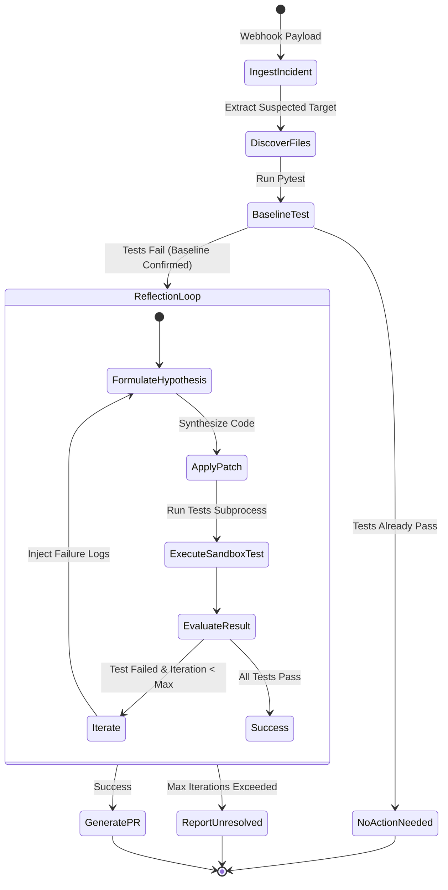

# 🏛️ SentinelAgent Architecture & Technical Specification

This document provides a formal, machine-readable specification of the **SentinelAgent** system, designed for human engineers, autonomous agents, and LLM evaluators.

---

## 1. System Overview

SentinelAgent is a tool-augmented autonomous agent that demonstrates incident
triage, root-cause diagnosis, candidate code patching, and test verification for
a local Python checkout. The checked-in entry point simulates one webhook
payload; it does not expose an HTTP server or create a remote pull request.

```
   [Simulated Incident Payload]
               │
               ▼
   ┌───────────────────────┐
    │ SentinelAgent Core    │
   └───────────┬───────────┘
               │
        (Local Tool Invocation)
               ├────────► [list_files / read_file]
               ├────────► [write_file (candidate patch)]
                ├────────► [run_tests (bounded pytest subprocess)]
               │                │
               │         (Stdout / Stderr)
               │                ▼
               └────────► [Self-Correction & Reflection Loop]
                                │
                         (Pass Confirmed)
                                ▼
                 [Unified Diff & PR Payload]
```

### Runtime and repository layout

| Path | Responsibility |
| :--- | :--- |
| `app/main.py` | Direct-execution CLI driver with a hard-coded incident simulation. |
| `app/agent.py` | Incident state machine, candidate generation, verification loop, and PR-payload formatting. |
| `app/tools.py` | Local file and subprocess adapter used by the agent. |
| `demo_repo/metrics_engine.py` | Intentionally unstable target fixture for the demo. |
| `demo_repo/test_metrics_engine.py` | Three pytest cases defining the repair contract. |
| `README.md` | Human quickstart, scope, replay instructions, and readiness checklist. |
| `LLMS.txt` | Concise machine-readable project context. |

Supported invocation is `python3 app/main.py` from the repository root. The
repository does not currently publish package metadata or a console-script
entry point. The only runtime dependency required for deterministic execution
is `pytest`; the optional OpenAI path additionally requires the `openai`
package and `OPENAI_API_KEY`.

---

## 2. Formal State Machine Specification

The agent operates as a finite state machine with bounded iterations:



### State Transitions Table

| Current State | Condition / Event | Next State | Action / Tool Executed |
| :--- | :--- | :--- | :--- |
| `IDLE` | Receive simulated payload | `INGEST_INCIDENT` | Read incident dictionary and target file |
| `INGEST_INCIDENT` | Parse complete | `DISCOVER_FILES` | Call `sandbox.list_files()` |
| `DISCOVER_FILES` | Files indexed | `BASELINE_TEST` | Call `sandbox.run_tests()` |
| `BASELINE_TEST` | `passed == True` | `NO_ACTION_NEEDED` | Terminate without changes |
| `BASELINE_TEST` | `passed == False` | `REFLECTION_LOOP` | Set `iteration = 1`, record failure |
| `REFLECTION_LOOP` | Generate Patch | `APPLY_PATCH` | Generate deterministic scenario patch or call the optional OpenAI provider |
| `APPLY_PATCH` | File written | `SANDBOX_TEST` | Call `sandbox.run_tests()` |
| `SANDBOX_TEST` | `passed == True` | `GENERATE_PR` | Compute diff, format PR body |
| `SANDBOX_TEST` | `passed == False` & `i < max` | `REFLECTION_LOOP` | Increment `i`, feed trace into prompt |
| `SANDBOX_TEST` | `passed == False` & `i >= max` | `UNRESOLVED` | Restore the original target and return diagnostic history |

---

## 3. Data Schemas (JSON)

### 3.1 Incident Ingestion Schema (`incident_payload`)
```json
{
  "$schema": "https://json-schema.org/draft/2020-12/schema",
  "title": "IncidentPayload",
  "type": "object",
  "properties": {
    "incident_id": { "type": "string" },
    "timestamp": { "type": "string", "format": "date-time" },
    "service": { "type": "string" },
    "error_type": { "type": "string" },
    "message": { "type": "string" },
    "suspected_file": { "type": "string" },
    "stack_trace": { "type": "string" }
  },
  "required": ["incident_id", "error_type", "message", "suspected_file"]
}
```

### 3.2 Tool Execution Result Schema (`sandbox.run_tests()`)
```json
{
  "$schema": "https://json-schema.org/draft/2020-12/schema",
  "title": "TestResult",
  "type": "object",
  "properties": {
    "passed": { "type": "boolean" },
    "exit_code": { "type": "integer" },
    "stdout": { "type": "string" },
    "stderr": { "type": "string" }
  },
  "required": ["passed", "exit_code", "stdout", "stderr"]
}
```

### 3.3 Output Pull Request Schema (`result["pr"]`)
```json
{
  "$schema": "https://json-schema.org/draft/2020-12/schema",
  "title": "PullRequestPayload",
  "type": "object",
  "properties": {
    "title": { "type": "string" },
    "body": { "type": "string" },
    "diff": { "type": "string" }
  },
  "required": ["title", "body", "diff"]
}
```

---

## 4. Sandbox Tool Interfaces (`app/tools.py`)

The agent interacts with the target codebase exclusively through the `CodebaseSandbox` abstraction layer:

1. `list_files() -> List[str]`
   * **Contract:** Scans repository root recursively and returns relative paths to all Python source/test files.
   * **Side Effects:** Read-only.
   * **Boundary:** Results are relative to the configured repository and are not a general filesystem listing.

2. `read_file(relative_path: str) -> str`
   * **Contract:** Reads an existing repository-relative file as UTF-8. Rejects absolute paths, `..` escapes, and symlink targets outside the repository.
   * **Side Effects:** Read-only.

3. `write_file(relative_path: str, content: str) -> str`
   * **Contract:** Atomically replaces an existing repository-relative file with UTF-8 content.
   * **Side Effects:** Mutates the target checkout. It is not a commit, branch, or remote PR operation.

4. `run_tests() -> Dict[str, Any]`
   * **Contract:** Spawns the current Python interpreter with `-m pytest -v`, captures output, and applies a 30-second timeout.
   * **Side Effects:** Executes arbitrary test/code subprocesses within `repo_dir`; this is process-bounded but not container-isolated.

5. `get_diff() -> str`
   * **Contract:** Computes a git diff for the configured repository against its current `HEAD`.
   * **Side Effects:** Read-only git subprocess.

The current agent computes its PR diff directly from the original and final
target-file contents rather than calling `get_diff()`.

---

## 5. Failure Recovery & Guardrails

1. **Timeout Protection:** Subprocess execution in `run_tests()` is capped at 30 seconds to defend against infinite loops in candidate patches.
2. **Path Confinement:** File reads and writes are resolved beneath `repo_dir`; absolute paths, traversal, and external symlink targets are rejected.
3. **Atomic Candidate Writes:** Candidate contents are written to a temporary file in the target directory and installed with `os.replace()`.
4. **Rollback on Exhaustion:** If all candidates fail, the original target contents are restored before returning `UNRESOLVED`. A successful candidate remains in the checkout for inspection.
5. **Deterministic Evaluation Fallback:** If `OPENAI_API_KEY` is unavailable or the provider call fails, the agent activates the deterministic metrics scenario synthesis. `GEMINI_API_KEY` is not implemented as a provider.
6. **Bounded Reflection Depth:** Enforced by `max_iterations = 3`, preventing infinite retry cycles.

## 6. Candidate Lifecycle and Observable Outcomes

1. Capture the original contents of the incident's target file.
2. Run the baseline suite. If it passes, return `NO_ACTION_NEEDED` without
   writing the target.
3. Generate and atomically write a candidate, then run `python -m pytest -v`
   from the target repository.
4. Record the hypothesis and test output in `history`. Failed candidates feed
   their output into the next reflection attempt.
5. On `RESOLVED`, leave the final candidate in the local checkout and return a
   `PullRequestPayload` with a diff against the captured original.
6. On `UNRESOLVED`, restore the captured original and return the iteration
   history. Exceptions from malformed input or unavailable files are not
   converted into a full remote incident workflow; callers should treat them
   as local execution errors.

The CLI renders `RESOLVED` as a generated PR payload, `NO_ACTION_NEEDED` as a
successful no-op, and `UNRESOLVED` as a failed bounded attempt. A PR payload is
an output artifact only: no branch, commit, authentication, or GitHub API call
occurs in this repository.

## 7. Provider and Patch Contracts

The optional provider path uses `OPENAI_API_KEY` and requests JSON containing:

```json
{
  "hypothesis": "short explanation",
  "new_code": "complete UTF-8 source for the target file"
}
```

Both values must be strings. Provider failures or malformed responses fall back
to deterministic synthesis. The built-in synthesis is intentionally scoped to
the `metrics_engine.py` demo incident and is not a general-purpose patch
planner.

## 8. Security and Deployment Boundary

`CodebaseSandbox` is a local file/subprocess adapter, not a hardened sandbox.
It prevents accidental path escapes and bounds pytest wall-clock time, but test
code still runs with the invoking user's permissions and network access. A
production deployment would need an isolated worker/container, resource and
network limits, authenticated webhook validation, a provider abstraction, and
an explicit Git branch/commit/PR integration before accepting untrusted
incidents.
