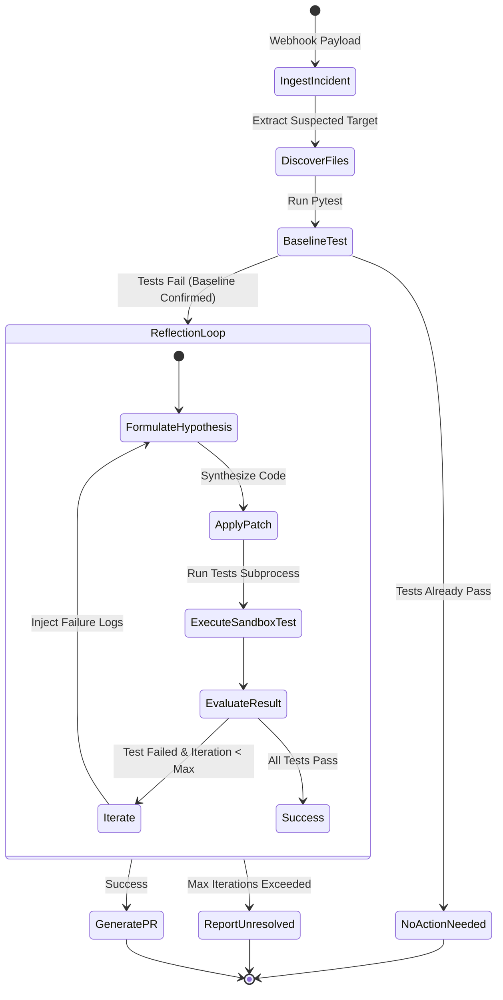

# 🏛️ SentinelAgent Architecture & Technical Specification

This document provides a formal, machine-readable specification of the **SentinelAgent** system, designed for human engineers, autonomous agents, and LLM evaluators.

---

## 1. System Overview

SentinelAgent is a deterministic, tool-augmented autonomous agent that automates the incident triage, root cause diagnosis, code patching, and verification lifecycle for software services.

```
       [Incident Webhook]
               │
               ▼
   ┌───────────────────────┐
   │ SentinelAgent Core    │
   └───────────┬───────────┘
               │
       (Tool Invocation)
               ├────────► [list_files / read_file]
               ├────────► [write_file (candidate patch)]
               ├────────► [run_tests (pytest subprocess)]
               │                │
               │         (Stdout / Stderr)
               │                ▼
               └────────► [Self-Correction & Reflection Loop]
                                │
                         (Pass Confirmed)
                                ▼
                       [Unified Diff & PR Payload]
```

---

## 2. Formal State Machine Specification

The agent operates as a finite state machine with bounded iterations:



### State Transitions Table

| Current State | Condition / Event | Next State | Action / Tool Executed |
| :--- | :--- | :--- | :--- |
| `IDLE` | Ingest Webhook | `INGEST_INCIDENT` | Parse incident schema & target file |
| `INGEST_INCIDENT` | Parse complete | `DISCOVER_FILES` | Call `sandbox.list_files()` |
| `DISCOVER_FILES` | Files indexed | `BASELINE_TEST` | Call `sandbox.run_tests()` |
| `BASELINE_TEST` | `passed == True` | `NO_ACTION_NEEDED` | Terminate without changes |
| `BASELINE_TEST` | `passed == False` | `REFLECTION_LOOP` | Set `iteration = 1`, record failure |
| `REFLECTION_LOOP` | Generate Patch | `APPLY_PATCH` | Call `sandbox.write_file(target, code)` |
| `APPLY_PATCH` | File written | `SANDBOX_TEST` | Call `sandbox.run_tests()` |
| `SANDBOX_TEST` | `passed == True` | `GENERATE_PR` | Compute diff, format PR body |
| `SANDBOX_TEST` | `passed == False` & `i < max` | `REFLECTION_LOOP` | Increment `i`, feed trace into prompt |
| `SANDBOX_TEST` | `passed == False` & `i >= max` | `UNRESOLVED` | Abort, generate diagnostic report |

---

## 3. Data Schemas (JSON)

### 3.1 Incident Ingestion Schema (`incident_payload`)
```json
{
  "$schema": "https://json-schema.org/draft/2020-12/schema",
  "title": "IncidentPayload",
  "type": "object",
  "properties": {
    "incident_id": { "type": "string" },
    "timestamp": { "type": "string", "format": "date-time" },
    "service": { "type": "string" },
    "error_type": { "type": "string" },
    "message": { "type": "string" },
    "suspected_file": { "type": "string" }
  },
  "required": ["incident_id", "error_type", "message", "suspected_file"]
}
```

### 3.2 Tool Execution Result Schema (`sandbox.run_tests()`)
```json
{
  "$schema": "https://json-schema.org/draft/2020-12/schema",
  "title": "TestResult",
  "type": "object",
  "properties": {
    "passed": { "type": "boolean" },
    "exit_code": { "type": "integer" },
    "stdout": { "type": "string" },
    "stderr": { "type": "string" }
  },
  "required": ["passed", "exit_code", "stdout", "stderr"]
}
```

### 3.3 Output Pull Request Schema (`result["pr"]`)
```json
{
  "$schema": "https://json-schema.org/draft/2020-12/schema",
  "title": "PullRequestPayload",
  "type": "object",
  "properties": {
    "title": { "type": "string" },
    "body": { "type": "string" },
    "diff": { "type": "string" }
  },
  "required": ["title", "body", "diff"]
}
```

---

## 4. Sandbox Tool Interfaces (`app/tools.py`)

The agent interacts with the target codebase exclusively through the `CodebaseSandbox` abstraction layer:

1. `list_files() -> List[str]`
   * **Contract:** Scans repository root recursively and returns relative paths to all Python source/test files.
   * **Side Effects:** Read-only.

2. `read_file(relative_path: str) -> str`
   * **Contract:** Reads file content as a UTF-8 string. Raises `FileNotFoundError` if invalid path.
   * **Side Effects:** Read-only.

3. `write_file(relative_path: str, content: str) -> str`
   * **Contract:** Atomically replaces destination file content with new code.
   * **Side Effects:** File modification.

4. `run_tests() -> Dict[str, Any]`
   * **Contract:** Spawns a sandboxed subprocess executing `pytest -v`. Captures output with a 30-second timeout.
   * **Side Effects:** Subprocess execution within `repo_dir`.

5. `get_diff() -> str`
   * **Contract:** Computes unified git diff representing all working directory changes against `HEAD`.
   * **Side Effects:** Read-only git subprocess.

---

## 5. Failure Recovery & Guardrails

1. **Timeout Protection:** Subprocess execution in `run_tests()` is capped at 30 seconds to defend against infinite loops in candidate patches.
2. **Deterministic Evaluation Fallback:** If an LLM provider key (`OPENAI_API_KEY` / `GEMINI_API_KEY`) is unavailable or rate-limited, the agent activates deterministic heuristic synthesis, ensuring zero fatal crashes during judging or CI automation.
3. **Bounded Reflection Depth:** Enforced by `max_iterations = 3`, preventing infinite retry cycles.
