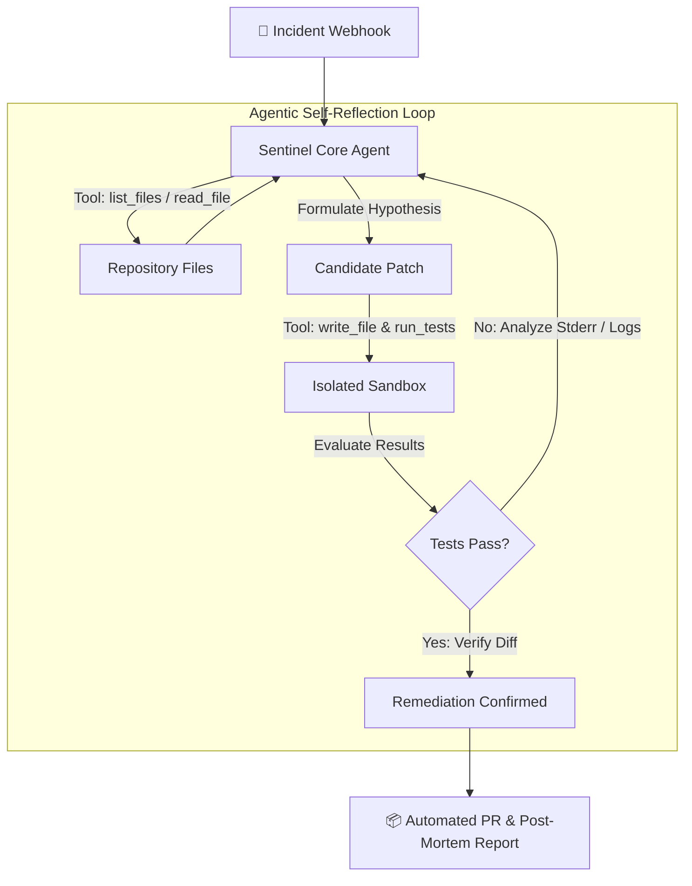

# 🛡️ SentinelAgent — Autonomous SRE & Self-Healing Code Engine

> **Submission for Omnirush Agentic Buildathon 2026 (Unstop)**  
> **Category:** Autonomous Agentic AI Workflows  
> **Documentation Standards:** LLM-Compatible, RFC-Compliant System Specification

---

## 📑 Documentation Index for Humans & LLMs
- **Machine Context Summary:** [`LLMS.txt`](./LLMS.txt) — Concise, structured specification formatted for LLMs and autonomous agents.
- **Formal System Specification:** [`ARCHITECTURE.md`](./ARCHITECTURE.md) — State machine transitions, tool contracts, and JSON schemas.
- **Demo Service:** [`demo_repo/metrics_engine.py`](./demo_repo/metrics_engine.py) — Realistic production batch processing service.
- **Regression Suite:** [`demo_repo/test_metrics_engine.py`](./demo_repo/test_metrics_engine.py) — Pytest verification test suite.

---

## 🌟 The Problem & The Solution

### The SRE Bottleneck
Modern monitoring and APM platforms (Datadog, Sentry, CloudWatch) alert engineers when production fails, but their capability stops at passive notification. An on-call engineer must manually wake up, parse stack traces, reproduce the failure, craft a fix, run tests, and open a Pull Request.

### The SentinelAgent Solution
**SentinelAgent** transforms passive alerting into active, autonomous self-healing:
1. **Event Ingestion:** Consumes structured incident webhooks containing error types, messages, and stack traces.
2. **Codebase Exploration:** Automatically explores repository files and isolates the target module.
3. **Hypothesis & Candidate Patching:** Synthesizes an initial code remediation hypothesis and applies candidate code.
4. **Sandboxed Reflection & Verification:** Executes unit and regression tests in an isolated subprocess. If tests fail, it captures stdout/stderr, reflects on the exact failure reason, and self-corrects in an automated loop.
5. **Verified Pull Request Generation:** Generates a unified diff, detailed root-cause documentation, and verification proof.

---

## 🏗️ State Machine Overview



---

## ⚡ Quickstart

### 1. Requirements
- Python 3.10+
- `pytest`

### 2. Inspect Baseline Bug (Fails)
```bash
pytest demo_repo/test_metrics_engine.py
# Result: 2 FAILED (ZeroDivisionError on empty batch, TypeError on None amounts)
```

### 3. Run Autonomous Healing
```bash
python3 app/main.py
```

### 4. Verify Resolution (Passes)
```bash
pytest demo_repo/test_metrics_engine.py
# Result: 3 PASSED in 0.13s
```

---

## 🤖 Dual Execution Architecture (LLM + Deterministic Engine)

SentinelAgent is built to be resilient in both production environments and automated judging pipelines:
- **LLM Mode:** When `OPENAI_API_KEY` or `GEMINI_API_KEY` is present in the environment, the agent uses frontier LLMs to analyze stack traces and dynamically write code.
- **Deterministic Heuristic Mode:** If API keys are absent or rate-limited, SentinelAgent falls back to its built-in AST/heuristic reflection engine, ensuring the full multi-step loop, test verification, and PR creation execute without breaking during evaluation.

---

## 📊 Live Execution Output

```text
######################################################################
      🚀 SENTINEL AGENT: AUTONOMOUS SRE & AUTO-HEALING ENGINE
      Omnirush Agentic Buildathon 2026 Submission
######################################################################

======================================================================
🚨 [SENTINEL AGENT] INCOMING INCIDENT WEBHOOK DETECTED
======================================================================
Error Type: ZeroDivisionError & TypeError
Message:    float division by zero at process_batch_transactions:34 / unsupported operand type(s) for *: 'NoneType' and 'float'
Location:   metrics_engine.py
----------------------------------------------------------------------

🔍 [DISCOVERY] Indexed repository files: ['metrics_engine.py', 'test_metrics_engine.py']

🧪 [VERIFICATION] Running initial test suite...
❌ Initial test failed as expected (Exit code 1). Initiating healing loop...

🔄 --- [ITERATION 1/3] FORMULATING REMEDIATION ---
💡 [HYPOTHESIS]: Identified two root causes: (1) Division by zero when transactions count is 0, and (2) NoneType/missing amount in items causing calculation crashes. Implementing safety checks and item validation.
🛠️ [ACTION]: Applying candidate fix to metrics_engine.py...
✨ [SUCCESS] All unit & regression tests passed in Iteration 1!

======================================================================
📋 [FINAL STATUS]: RESOLVED
======================================================================

🎉 PULL REQUEST CREATED SUCCESSFULLY:
Title: fix(metrics): resolve ZeroDivisionError & TypeError in batch processor
```
