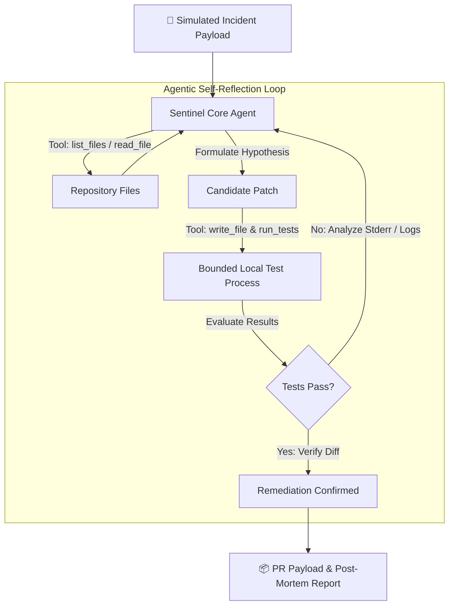

# 🛡️ SentinelAgent — Autonomous SRE & Self-Healing Code Engine

> **Submission for Omnirush Agentic Buildathon 2026 (Unstop)**  
> **Category:** Autonomous Agentic AI Workflows  
> **Documentation Standards:** LLM-Compatible, RFC-Compliant System Specification

> **Submission status:** Buildathon demo-ready. The checked-in scenario is a
> local, deterministic incident-remediation demonstration. It is not a
> production webhook service, container sandbox, or GitHub PR publisher.

---

## 📑 Documentation Index for Humans & LLMs
- **Machine Context Summary:** [`LLMS.txt`](./LLMS.txt) — Concise, structured specification formatted for LLMs and autonomous agents.
- **Formal System Specification:** [`ARCHITECTURE.md`](./ARCHITECTURE.md) — State machine transitions, tool contracts, and JSON schemas.
- **Demo Service:** [`demo_repo/metrics_engine.py`](./demo_repo/metrics_engine.py) — Realistic production batch processing service.
- **Regression Suite:** [`demo_repo/test_metrics_engine.py`](./demo_repo/test_metrics_engine.py) — Pytest verification test suite.

---

## 🌟 The Problem & The Solution

### The SRE Bottleneck
Modern monitoring and APM platforms (Datadog, Sentry, CloudWatch) alert engineers when production fails, but their capability stops at passive notification. An on-call engineer must manually wake up, parse stack traces, reproduce the failure, craft a fix, run tests, and open a Pull Request.

### The SentinelAgent Solution
**SentinelAgent** transforms passive alerting into active, autonomous self-healing:
1. **Event Ingestion:** Accepts a structured incident payload; `app/main.py` currently supplies a hard-coded local webhook simulation.
2. **Codebase Exploration:** Automatically explores repository files and isolates the target module.
3. **Hypothesis & Candidate Patching:** Synthesizes an initial code remediation hypothesis and applies candidate code.
4. **Sandboxed Reflection & Verification:** Executes unit and regression tests in a bounded subprocess. If tests fail, it captures stdout/stderr, reflects on the exact failure reason, and self-corrects in an automated loop.
5. **Verified Pull Request Artifact:** Generates a unified diff, detailed root-cause documentation, and verification proof. The demo does not open a remote pull request.

---

## 🏗️ State Machine Overview



---

## ⚡ Quickstart

### 1. Requirements
- Python 3.10+
- `pytest` (installed in the active Python environment)

Create a reproducible local environment from the repository root:

```bash
python3 -m venv .venv
. .venv/bin/activate
python -m pip install --upgrade pip
python -m pip install pytest
```

### 2. Inspect the baseline bug (expected failure)
```bash
pytest demo_repo/test_metrics_engine.py
# Expected result from a clean checkout: 1 passed, 2 failed.
# Failures: ZeroDivisionError on an empty batch and TypeError on None amounts.
```

### 3. Run autonomous healing
```bash
python3 app/main.py
# Expected result: [FINAL STATUS]: RESOLVED
# The command mutates demo_repo/metrics_engine.py in place.
```

### 4. Verify the resolution (passes)
```bash
pytest demo_repo/test_metrics_engine.py
# Expected result: 3 passed.
```

To replay the clean demonstration, use a fresh checkout or restore only the
demo fixture after inspecting the generated diff:

```bash
git restore --source=HEAD -- demo_repo/metrics_engine.py
```

If the fixture is already fixed, a subsequent run reports
`NO_ACTION_NEEDED`; it does not create another candidate patch.

---

## 🤖 Dual Execution Architecture (LLM + Deterministic Engine)

SentinelAgent is built to be resilient in automated judging pipelines:
- **LLM Mode (optional):** When `OPENAI_API_KEY` is present, the agent calls the OpenAI client using the configured model in `app/agent.py` and validates the returned JSON contract. No API key is required for the demo.
- **Deterministic Heuristic Mode (default for judging):** If the OpenAI key is absent or the provider call fails, SentinelAgent falls back to its built-in scenario-specific synthesis engine. This keeps the multi-step loop and test verification reproducible.

`GEMINI_API_KEY` is not a supported provider setting in this revision. The
deterministic path is the recommended buildathon replay path; never commit API
keys to the repository.

## 🎯 Demo Scope and Submission Contract

The submitted flow is intentionally small and reviewable:

- `app/main.py` simulates one incident for `demo_repo/metrics_engine.py`; it is
  not an HTTP webhook listener.
- The deterministic repair handles the two seeded metrics failures: empty
  batches and missing or null transaction amounts. It is not a general patch
  synthesizer for arbitrary repositories.
- `CodebaseSandbox` operates on a local checkout. It bounds the pytest process
  and rejects repository path escapes, but it is not a container or a complete
  security boundary.
- A successful run emits a `PullRequestPayload` containing a title, body, and
  unified diff. It does not create a branch, commit, or remote GitHub PR.
- If all candidate iterations fail, the original target file is restored;
  successful remediation remains in the demo checkout so the generated diff
  can be inspected.

## ✅ Buildathon Readiness Checklist

- [x] Clean-checkout baseline reproduces the two intended failures.
- [x] `python3 app/main.py` repairs the scenario in one deterministic iteration.
- [x] The post-remediation regression suite reports three passing tests.
- [x] README, architecture specification, and machine-readable context agree
  on the local-demo scope and output artifact.
- [x] No credentials or generated Python cache files are required in git.
- [ ] Production integrations (real webhook ingestion, provider abstraction,
  isolated container execution, and remote PR creation) remain future work.

---

## 📊 Live Execution Output

```text
######################################################################
      🚀 SENTINEL AGENT: AUTONOMOUS SRE & AUTO-HEALING ENGINE
      Omnirush Agentic Buildathon 2026 Submission
######################################################################

======================================================================
🚨 [SENTINEL AGENT] INCOMING INCIDENT WEBHOOK DETECTED
======================================================================
Error Type: ZeroDivisionError & TypeError
Message:    float division by zero at process_batch_transactions:34 / unsupported operand type(s) for *: 'NoneType' and 'float'
Location:   metrics_engine.py
----------------------------------------------------------------------

🔍 [DISCOVERY] Indexed repository files: ['metrics_engine.py', 'test_metrics_engine.py']

🧪 [VERIFICATION] Running initial test suite...
❌ Initial test failed as expected (Exit code 1). Initiating healing loop...

🔄 --- [ITERATION 1/3] FORMULATING REMEDIATION ---
💡 [HYPOTHESIS]: Identified two root causes: (1) Division by zero when transactions count is 0, and (2) NoneType/missing amount in items causing calculation crashes. Implementing safety checks and item validation.
🛠️ [ACTION]: Applying candidate fix to metrics_engine.py...
✨ [SUCCESS] All unit & regression tests passed in Iteration 1!

======================================================================
📋 [FINAL STATUS]: RESOLVED
======================================================================

🎉 PULL REQUEST PAYLOAD GENERATED:
Title: fix(metrics): resolve ZeroDivisionError & TypeError in batch processor
```

The output above is a representative local run. Exact timing and pytest
plugin details depend on the active Python environment.
