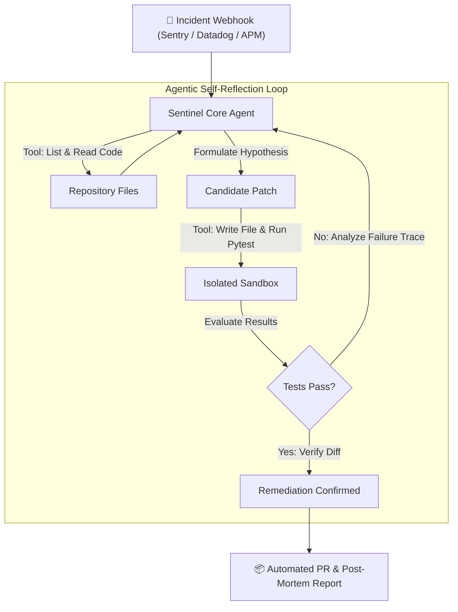

# 🛡️ SentinelAgent — Autonomous SRE & Self-Healing Code Engine

> **Submission for Omnirush Agentic Buildathon 2026 (Unstop)**  
> **Category:** Autonomous Agentic AI Workflows  
> **Author / Participant:** sundeep8967

---

## 🌟 The Vision

Traditional monitoring systems (Datadog, Sentry, CloudWatch) alert engineers when production fails, but they stop at notification. An on-call engineer still has to wake up at 3:00 AM, clone the repo, replicate the bug, craft a fix, run tests, and open a PR.

**SentinelAgent changes the paradigm from passive alerting to autonomous self-healing.**

When an unhandled exception or crash occurs in a production service:
1. **Ingests & Diagnoses:** Intercepts error webhooks and parses stack traces.
2. **Autonomous Tool Use:** Explores the target codebase and identifies broken functions and modules.
3. **Hypothesis & Patch Generation:** Formulates an engineering hypothesis and synthesizes minimal, defensive code patches.
4. **Sandboxed Verification & Reflection:** Executes unit and regression tests in an isolated sandbox. If tests fail, it reflects on the error output and iterates autonomously until all tests pass.
5. **Dispatches Pull Requests:** Creates a complete Pull Request with unified diffs, root cause explanations, and verification logs.

---

## 🏗️ System Architecture



---

## ⚡ Quickstart

### 1. Requirements
- Python 3.10+
- `pytest`

### 2. Run the Autonomous Agent Demo
```bash
cd sentinel-agent
python3 app/main.py
```

### 3. Verify Tests in the Demo Repo
Before running the agent:
```bash
pytest demo_repo/test_metrics_engine.py   # ❌ Fails (ZeroDivisionError & TypeError)
```

Run SentinelAgent:
```bash
python3 app/main.py                       # 🤖 Diagnoses, heals, runs tests, passes
```

After SentinelAgent runs:
```bash
pytest demo_repo/test_metrics_engine.py   # ✅ All 3 tests pass cleanly
```

---

## 💡 Key Agentic Features
- **Multi-Step Tool Use:** Uses dedicated sandbox tools (`list_files`, `read_file`, `write_file`, `run_tests`, `get_diff`).
- **Self-Correction & Reflection:** Doesn't just write code blindly; tests execution feedback in a loop before approving any change.
- **Fail-Safe Operation:** Bounded by `max_iterations` to prevent runaway agent loops.
- **Production-Ready Artifacts:** Outputs unified diffs and PR markdown descriptions matching professional engineering standards.
